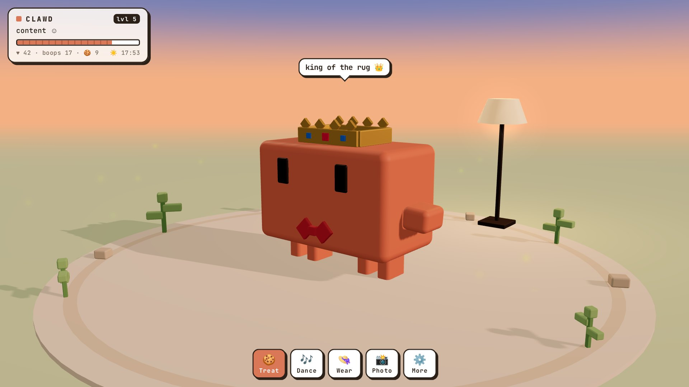
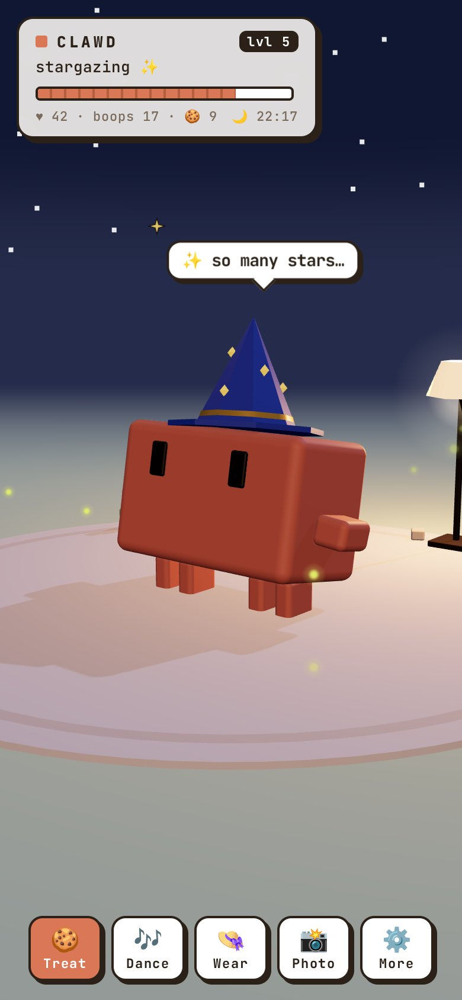
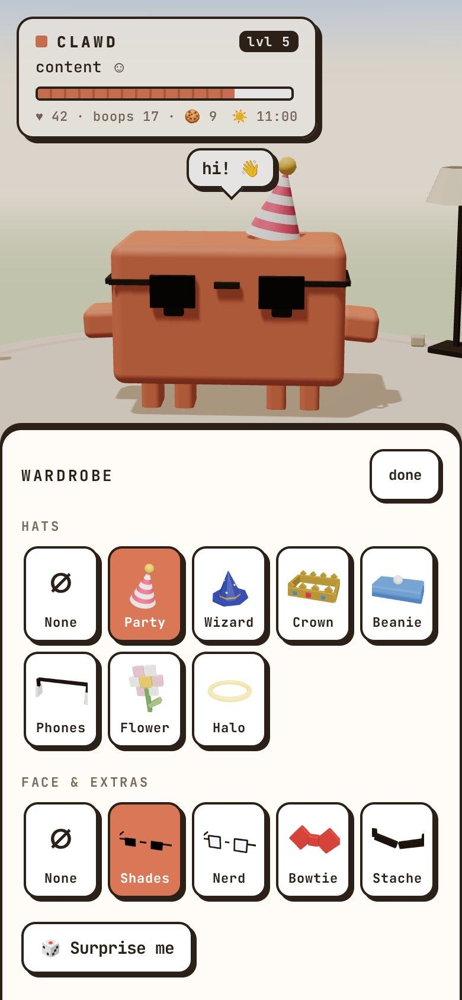
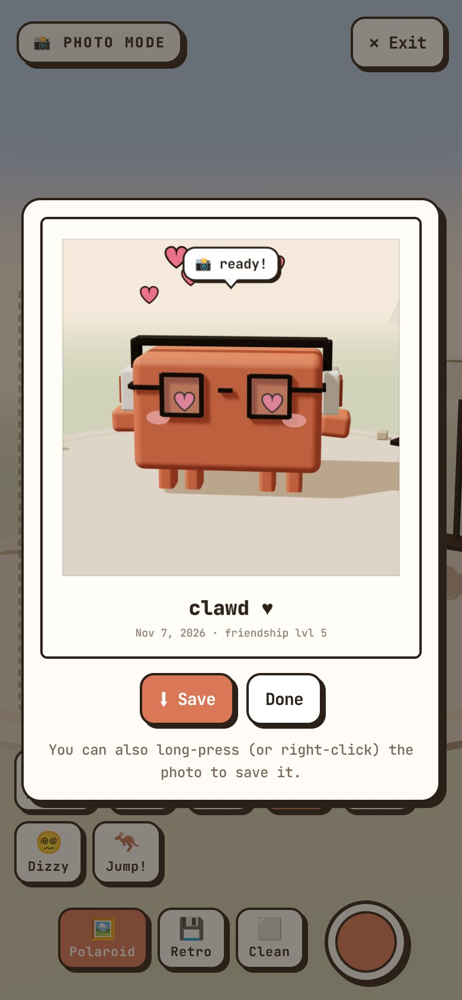

# Clawd

A small 3D virtual pet that lives on your clock. Stroke him, boop him, dress him up and take his photo.

**[Play it in your browser](https://ravindu644.github.io/clawd-pet/)**



| His sky follows your real clock | Eight hats, five face items | Snap a Polaroid |
| :---: | :---: | :---: |
|  |  |  |

The game builds into one file, `dist/clawd.html`, with everything inlined. Open it in a browser and it works with no network.

## Build

```sh
npm install
npm run build
```

This writes `dist/clawd.html`, which is not committed. Edit the files in `src/`.

## Play online

Every push to `main` builds the game and publishes it to GitHub Pages at https://ravindu644.github.io/clawd-pet/.

## Test

```sh
npm test
```

The tests run a dev build in headless Chromium through Playwright, so a browser has to be available:

```sh
npx playwright-core install chromium-headless-shell
```

Set `CHROME_PATH` to use a browser you already have.

## Not affiliated with Anthropic

This is an independent, unofficial fan project. It is not affiliated with, sponsored by or endorsed by Anthropic. The Clawd character is the property of Anthropic, and "Claude" and "Clawd" are trademarks of Anthropic.

Because the character belongs to Anthropic, this repository has no open-source licence. Keep that in mind before you fork or reuse it.

## Credits

Set in [JetBrains Mono](https://www.jetbrains.com/lp/mono/), under the SIL Open Font License 1.1 (`src/fonts/OFL.txt`). Three.js is MIT licensed.
